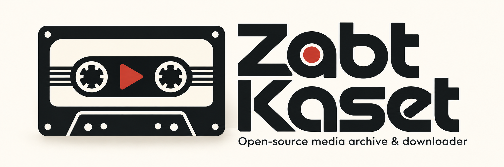

# Zabt Kaset

<p align="center">
  
</p>

Professional desktop media downloader and organizer for YouTube and beyond.

Zabt Kaset combines the queue discipline of classic download managers with a
modern desktop UX: single videos, playlists, channels, Shorts, community post
media, subtitles, metadata, and smart library organization.

> **Status:** early development (0.1.0). Core architecture, IPC contracts, and
> UI shell are in place. Download pipeline integrations are being hardened.

## Screenshots

| Light | Dark |
| ----- | ---- |
| _Coming soon_ | _Coming soon_ |

Place product screenshots in `assets/images/` and link them here before release.

## Features

- **Downloads** — single URL, batch URLs, playlists, channels, Shorts
- **Formats** — video (MP4, MKV, WEBM) and audio (MP3, M4A, OPUS, FLAC)
- **Subtitles** — Persian, English, Arabic, German, French · SRT, VTT, ASS, SSA, TTML
- **Assets** — thumbnails, description text, metadata JSON, community post media
- **Queue** — priority, pause / resume / cancel / retry with rich job states
- **History** — SQLite-backed search, filter, redownload, open location
- **Organizer** — template paths (`{channel}`, `{title}`, `{resolution}`, …)
- **Duplicates** — SHA-256, video ID, metadata, and filename matching
- **Presets** — Best Quality, Balanced, Mobile, Audio Only, Archive + custom
- **Auth** — browser cookie import (Chrome, Edge, Firefox, Brave) via secure storage
- **Proxy** — HTTP / HTTPS / SOCKS4 / SOCKS5 / SOCKS5H profiles with latency checks
- **Tools** — yt-dlp & FFmpeg detect, verify, and update
- **Desktop UX** — system tray, notifications, clipboard watch, drag-and-drop
- **i18n** — English + Persian with full RTL

## Architecture

```
┌─────────────────────────────┐
│  Next.js 15 (App Router)    │
│  React · Zustand · Query    │
└──────────────┬──────────────┘
               │ Tauri IPC
┌──────────────▼──────────────┐
│  Rust / Tauri v2            │
│  Commands · Services · Tokio│
└──────────────┬──────────────┘
               │
     ┌─────────┼─────────┐
     ▼         ▼         ▼
  SQLite    yt-dlp    FFmpeg
```

See [docs/architecture.md](docs/architecture.md).

## Tech stack

| Layer | Technology |
| ----- | ---------- |
| Desktop shell | Tauri v2 |
| Frontend | Next.js 15, TypeScript, Tailwind CSS, shadcn/ui, Radix, Lucide, Framer Motion |
| State | Zustand, TanStack Query |
| Forms | React Hook Form + Zod |
| i18n / themes | next-intl, next-themes |
| Backend | Rust, Tokio |
| Database | SQLite (Rust layer) |
| Media engine | yt-dlp, FFmpeg |

## Installation

### Prerequisites

- Node.js 20+
- pnpm 9+
- Rust (stable) via [rustup](https://rustup.rs/)
- [Tauri v2 prerequisites](https://v2.tauri.app/start/prerequisites/) for your OS
- yt-dlp and FFmpeg on `PATH` (or install later from Settings → Tools)

### Clone

```bash
git clone https://github.com/javadhashemzadehir/zabt-kaset.git
cd zabt-kaset
pnpm install
```

## Development

```bash
# Frontend only (browser)
pnpm dev

# Full desktop app
pnpm tauri:dev
```

More detail: [docs/development.md](docs/development.md).

## Build

```bash
pnpm tauri:build
```

Artifacts land under `src-tauri/target/release/bundle/`.  
See [docs/building.md](docs/building.md) and [docs/release.md](docs/release.md).

## Project layout

```
apps/desktop/     Next.js frontend
src-tauri/        Rust backend + Tauri config
docs/             Architecture and guides
scripts/          Dev and release helpers
.github/          CI and release workflows
.cursor/          Public agent rules & skills
.agents/          Agent playbooks (public)
```

## Contributing

Please read [CONTRIBUTING.md](CONTRIBUTING.md) and [CODE_OF_CONDUCT.md](CODE_OF_CONDUCT.md).

## Roadmap

- [x] Repository scaffold and documentation
- [x] SQLite schema and migration runner
- [x] Download queue IPC contracts
- [ ] Production yt-dlp job runner with progress events
- [ ] Channel incremental sync UI
- [ ] Cookie vault + OS keychain
- [ ] Auto organizer templates editor
- [ ] Signed multi-platform releases
- [ ] Plugin / preset marketplace (stretch)

## License

[MIT](LICENSE)

## Security

See [SECURITY.md](SECURITY.md) and [docs/security.md](docs/security.md).
